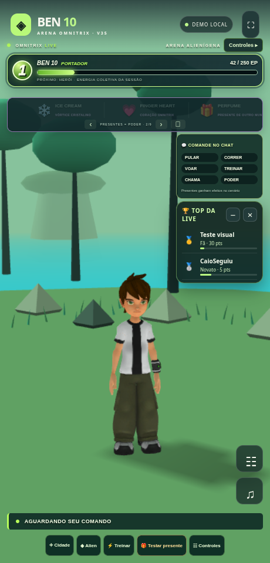

# Ben 10 LIVE V35 · Arena Omnitrix

[Baixar o ZIP V35](https://github.com/Elielpg/v4-ff/raw/refs/heads/main/BEN10_LIVE_V35_TERMUX.zip)



- Câmera adaptada à largura/altura de cada alien, deixando mais cenário visível.
- Presentes em slides com troca automática, navegação e pausa; 40 nomes padrão e 15 famílias de efeitos.
- Falas variadas para chegadas, comentários, seguidores e presentes usando a voz selecionada, em uma fila sem sobreposição.
- Articulação e postura revistas; novas silhuetas procedurais de Alien X e Cipó Selvagem; transições mais suaves e novos sons.

## Atualizar a instalação V34

Baixe o ZIP no celular. Se instalou a V34 em `~/ben10-v34/game`, execute no Termux:

```sh
cd ~/ben10-v34/game
bash backup.sh
bash update.sh --archive ~/storage/downloads/BEN10_LIVE_V35_TERMUX.zip --start
```

O atualizador preserva `data/` e `.env`. Se necessário, pare a sessão antiga com Ctrl+C. Abra o endereço indicado no Chrome e confirme **35.0.0**. Toque em **♫** para liberar vozes/sons. A conversa livre depende da chave Gemini; cumprimentos e respostas locais básicas funcionam sem ela. Gemini/ElevenLabs ou a voz PT-BR do navegador seguem a configuração disponível no aparelho.

Para instalação nova, extraia o ZIP, entre em `game` e execute `bash install.sh` e `bash start.sh`.

## Validação e conteúdo

118 testes passaram. As onze formas foram verificadas por projeção em tela no Chromium, junto com slides automáticos/manuais, novos presentes e reprodução serial de WAV de teste para chegada, comentário, seguidor e presente. ZIP extraído e servidor inicializado. Os WAVs controlados comprovam a fila/reprodução, sem validar uma voz externa. LIVE real, vozes de serviços e Android físico continuam dependendo do teste no aparelho/conta.

Os nove GLBs e respectivos créditos/licenças são preservados. A melhoria da articulação não substitui as malhas originais por assets de maior resolução. Código, fontes correspondentes, licenças e instruções completas (`game/docs/V35_NOVIDADES.md`) estão no ZIP. Sem chaves pessoais ou dados privados. Projeto de fã sem afiliação oficial.
