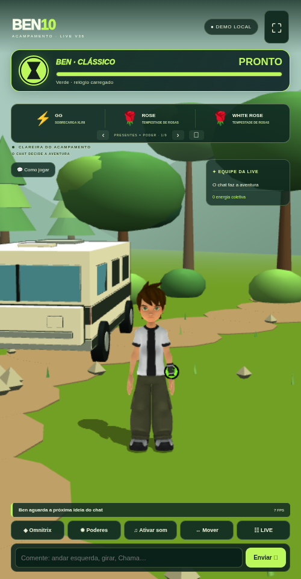

# Ben 10 LIVE V36 · Clareira controlada pelo chat

[Baixar o ZIP V36](https://github.com/Elielpg/v4-ff/raw/refs/heads/main/BEN10_LIVE_V36_TERMUX.zip)



- Cidade e missões retiradas do jogo ativo; nova clareira com floresta, acampamento e trailer inspirado no Lata Velha.
- Movimento livre para esquerda/direita, frente/trás, caminhada, corrida, salto, giro, pouso e voo em formas compatíveis. Dash e imagens residuais de XLR8.
- Onze formas com três poderes selecionáveis cada; novo Quatro Braços procedural com quatro braços articulados por membro.
- Omnitrix com seleção, animação/som de transformação, contador e barra verdes, retorno automático a Ben e recarga vermelha. Padrão de 45 segundos por carga e 18 de recarga, configurável.
- Chat, presentes, slides, vozes e agradecimentos mantidos. Presentes aguardam o relógio recarregar. Configurações antigas de missões não reativam o jogo anterior.

## Atualizar preservando configurações

Após baixar o ZIP no celular, se sua instalação está em `~/ben10-v34/game`:

```sh
cd ~/ben10-v34/game
bash backup.sh
bash update.sh --archive ~/storage/downloads/BEN10_LIVE_V36_TERMUX.zip --start
```

Se necessário, pare a sessão anterior com Ctrl+C. Abra o endereço indicado no Chrome, confira **V36 / 36.0.0** e toque em **♫ Ativar som**. O atualizador preserva `data/` e `.env`. Use sua pasta real se instalou em outro caminho.

Instalação nova: extraia, entre na pasta `game`, execute `bash install.sh` e `bash start.sh`.

Comandos: nome do alien, `andar esquerda`, `correr direita`, `frente`, `trás`, `pular`, `girar`, `parar`, `voar`, `pousar`, `dash` com XLR8, `poder 1/2/3` e `humano`.

## Validação

130 testes passaram. O navegador Chromium validou controle pelo chat, movimentos, seleção/transformação, três poderes de Chama, Quatro Braços, voo, dash/imagens residuais, relógio no pulso/HUD e presente aguardando recarga. Um ciclo real completo comprovou expiração automática, retorno a Ben, estado vermelho e recarga verde. O ZIP foi extraído e seu servidor iniciado em pasta limpa.

A fala foi testada com WAV controlado, sem comprovar vozes de serviços externos. LIVE real e desempenho em Android físico ainda precisam ser verificados no aparelho/conta. Conversa livre exige Gemini; há falas locais básicas e fallback de voz do navegador. Sem chaves pessoais no pacote.

Guia completo no ZIP: `game/docs/V36_NOVIDADES.md`. Modelos GLB, créditos e licenças são preservados; os novos elementos são interpretações procedurais de fã, sem afiliação oficial ou gravações da dublagem.
