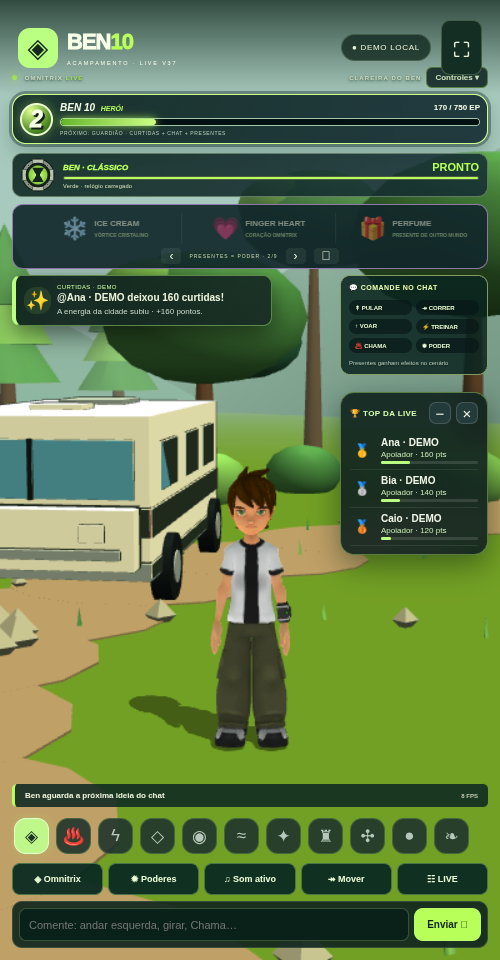

# Ben 10 LIVE V37 · Padrão visual anterior recuperado

[Baixar o ZIP V37](https://github.com/Elielpg/v4-ff/raw/refs/heads/main/BEN10_LIVE_V37_TERMUX.zip)



Esta versão corrige a mudança visual da V36 e mantém a clareira/movimento livre, sem cidade ou missões.

- Ícones das formas, marca verde e faixa de energia no padrão anterior.
- Ranking **🏆 TOP DA LIVE** com medalhas, níveis, barras de progresso, recolher/ocultar e aba completa.
- Quadro **💬 COMANDE NO CHAT** permanentemente visível, com os comandos anteriores em pílulas.
- Omnitrix original da malha do Ben, incluindo pulseira e desenho. Retirado o símbolo flutuante. Só os pixels verdes do próprio relógio mudam para vermelho na recarga; a textura original retorna ao carregar.
- Caixa/aro/símbolo do relógio no painel refinados. Transformação conserva os anéis e faíscas e acrescenta hélice de DNA e selo. Poderes preservam as habilidades e coreografias, com partículas adicionais de preparação e impacto.

## Atualizar preservando dados

Depois de baixar o ZIP no celular, na pasta usada anteriormente:

```sh
cd ~/ben10-v34/game
bash backup.sh
bash update.sh --archive ~/storage/downloads/BEN10_LIVE_V37_TERMUX.zip --start
```

Use sua pasta real se instalou em outro lugar. Confira **V37 / 37.0.0** no Chrome. O atualizador preserva `data/` e `.env`. Toque em ♫ para vozes/sons; Controles abre a faixa dos onze ícones. O quadro de comandos fica visível independentemente desse botão.

Para instalação nova, extraia, entre em `game`, execute `bash install.sh` e `bash start.sh`.

## Verificação

133 testes passaram. O navegador validou ícones, ranking com medalhas/progresso, painel de comandos sempre visível, seleção/transformação, três poderes e o relógio original mudando vermelho/verde sem trocar sua geometria. Também verificou retrato, 360 pixels e paisagem, descarte de partículas e ausência de cidade/missões no cenário. O ZIP é extraído e iniciado pelo teste de distribuição.

LIVE real, vozes externas e Android físico ainda precisam de verificação no aparelho/conta. A conversa livre exige Gemini configurado. Chaves pessoais não acompanham o pacote. Guia completo: `game/docs/V37_CORRECAO_INTERFACE.md`. Créditos, fontes e licenças estão preservados.
