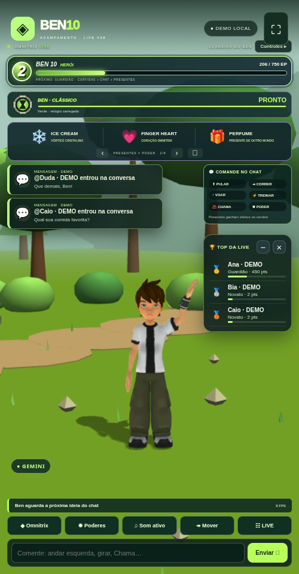

# Ben 10 LIVE V38 · Voz, Gemini e movimentos

[Baixar BEN10_LIVE_V38_TERMUX.zip](https://github.com/Elielpg/v4-ff/raw/refs/heads/main/BEN10_LIVE_V38_TERMUX.zip)



- Gemini também recebe perguntas de identidade. Respostas locais por falta de chave, conexão ou cota ficam identificadas na tela.
- Até 20 chaves: adicionar individualmente ou uma por linha, selecionar manualmente, excluir e testar a selecionada. Nomes distintos e correção da seleção após remover a ativa.
- Voz gratuita do aparelho, sem chave TTS, com seleção de voz PT-BR e ajuste de tom/ritmo do Ben. Gemini pode gerar o texto e a voz gratuita pode lê-lo. As vozes são interpretações; o timbre depende do dispositivo.
- Sentar num banquinho, levantar, sorrir, piscar, movimentar sobrancelhas/mandíbula, acenar para visitantes e responder com gestos. Acenos durante a caminhada preservam o movimento das pernas.
- Passeios e descansos ocasionais, interrompidos por comandos. O comportamento espontâneo pode ser desligado nos ajustes.
- Ícones, ranking, painel do chat, Omnitrix original, transformações, recarga verde/vermelha e poderes da V37 preservados. Sem cidade ou missões.

## Atualizar no Termux

Depois de baixar o ZIP, use a pasta anterior (ajuste o caminho se necessário):

```sh
cd ~/ben10-v34/game
bash backup.sh
bash update.sh --archive ~/storage/downloads/BEN10_LIVE_V38_TERMUX.zip --start
```

Confira **V38 / 38.0.0** no Chrome. O atualizador preserva `data/` e `.env`. Para iniciar outra vez, dentro da mesma pasta: `bash start.sh`.

Instalação nova: extraia o ZIP, entre em `game`, execute `bash install.sh` e `bash start.sh`.

## Ativar voz e IA

Em **☷ LIVE → IA e voz**:

1. Cadastre suas chaves Gemini, clique em **Usar** e **Salvar modelo e testar chave selecionada**. O modelo de texto padrão é `gemini-2.5-flash`, editável. Cada projeto Google tem sua própria cota; não há troca automática de chave.
2. Escolha **Grátis · voz do aparelho, sem chave** e **Salvar provedor de voz**. A atualização mantém a escolha anterior até você mudar. Escolha a voz em português e teste. Toque em **♫ Ativar som**.
3. Se faltar voz, instale **Português (Brasil)** nas configurações de **Texto para voz** do Android e reabra o Chrome. A opção depende das vozes e do mecanismo do aparelho; algumas vozes podem exigir internet. Gemini TTS e ElevenLabs permanecem opcionais, sujeitos a cota/créditos da conta.

Comandos novos: `sentar`, `levantar`, `sorrir`, `acenar`, `comemorar`. Conversas comuns passam pela fila Gemini quando há chave; boas-vindas e agradecimentos rápidos usam frases locais variadas.

## Verificação

**139 testes passaram**, além de duas verificações no Chromium: novas expressões/posturas, cadastro e seleção de três chaves, modo gratuito sem requisição TTS paga, identificação Gemini/local, ranking, ícones, três poderes, relógio original vermelho/verde e layouts de celular/paisagem. O ZIP final foi extraído e seu servidor iniciado pelo teste de distribuição; integridade conferida e nenhum `data/`, `.env` pessoal ou `node_modules` incluído.

O fluxo de voz e o modo Gemini na interface foram exercitados com fixtures, sem chave Google real. A máquina cloud não tinha voz PT-BR instalada. Timbre/áudio em Android físico e conexão a uma LIVE real precisam de verificação no aparelho/conta. A prévia mostra uma demonstração local. Relatórios, fontes e guia completo estão no ZIP em `game/reports/v38/` e `game/docs/V38_VOZ_E_MOVIMENTOS.md`. Créditos/licenças preservados.

[Checksum SHA-256](BEN10_LIVE_V38_TERMUX.zip.sha256)
