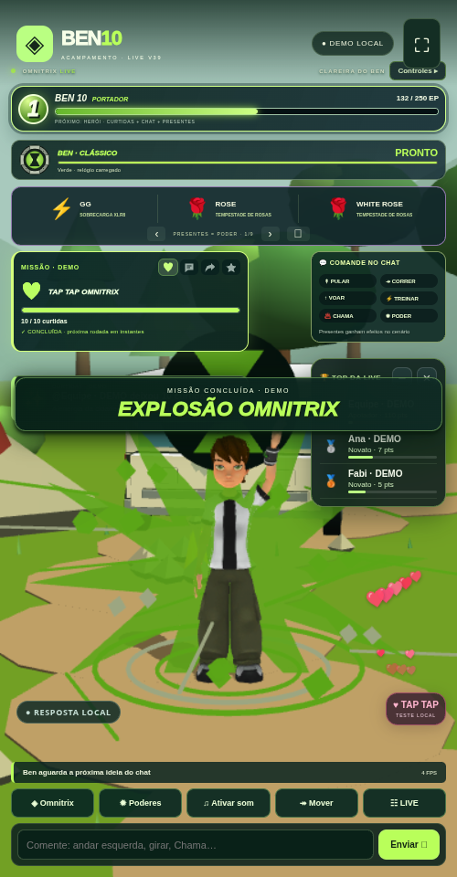

# Ben 10 LIVE V39 · TAP TAP, missões do chat e efeitos 3D

[Baixar BEN10_LIVE_V39_TERMUX.zip](https://github.com/Elielpg/v4-ff/raw/refs/heads/main/BEN10_LIVE_V39_TERMUX.zip)



A atualização mantém o ranking, os ícones, o painel de comandos, o Omnitrix original e o sistema de voz/chaves da V38.

- Corações animados sobem pela lateral quando chegam curtidas da LIVE.
- Quatro missões coletivas simultâneas: **500 curtidas**, **20 comentários**, **3 compartilhamentos** ou **3 novos seguidores**, com metas editáveis.
- Cada missão libera uma celebração 3D: Explosão Omnitrix, Cristais de Diamante, Túnel de Velocidade ou Sinal dos Heróis.
- Chamas 3D animadas, raios com núcleo claro, cristais facetados e contornos, correntes de água, cipós, selos, DNA, ondas e detritos acrescentados aos poderes das onze formas.
- Novos gestos de **vitória** e **pose de herói**. Câmera se afasta suavemente durante os poderes para enquadrar o efeito.

## Atualizar no Termux

Depois de baixar o ZIP, entre na pasta da instalação anterior (ajuste o caminho se necessário):

```sh
cd ~/ben10-v34/game
bash backup.sh
bash update.sh --archive ~/storage/downloads/BEN10_LIVE_V39_TERMUX.zip --start
```

Confira **V39 / 39.0.0** no Chrome. O atualizador preserva `data/`, `.env` e suas chaves. Para iniciar novamente, na mesma pasta: `bash start.sh`.

Instalação nova: extraia o ZIP, entre em `game`, execute `bash install.sh` e `bash start.sh`.

## Usar as novidades

**☷ LIVE → Laboratório → Missões do chat** permite mudar as metas, desligá-las ou reiniciar o progresso. Os quatro ícones no cartão à esquerda alternam a missão exibida; todas contam ao mesmo tempo. Após concluir, há uma pausa de 12 segundos antes da próxima rodada. Configurações são salvas; o progresso pertence à sessão do servidor.

Conecte a LIVE pelo seu @ para receber as interações reais. Curtidas enviadas pelo conector geram os corações e avançam a meta. Na demonstração local, tocar no cenário ou no botão **♥ TAP TAP — TESTE LOCAL** testa os corações e a missão DEMO. Durante a LIVE, o botão muda para **PRÉVIA LOCAL** e só mostra a animação; ele não envia nem soma curtidas reais.

**DEMO e TikTok têm progressos separados.** O cartão indica a origem. A prévia acima usa valores de teste locais. Os valores padrão do pacote são os indicados no início deste guia.

Use `pose`, `pose de herói` ou `vitória` no chat, ou os botões em **Mover**. Todos os comandos anteriores continuam disponíveis. Ative **♫** para sons e falas. O modo **Econômico** reduz elementos dos efeitos e corações.

As missões são metas da comunidade; o cenário continua sendo a clareira. As tarefas antigas de cidade/NPC não foram reativadas. Ben reconhece as metas nas respostas, celebra os resultados e pode agradecer pela voz, quando as falas estão ativadas.

## Verificação

**148 testes passaram**, incluindo contagem/deduplicação, separação de origens, rodadas, limites de repetição, HTTP/SSE, persistência, poses, efeitos das onze formas e descarte dos recursos. A conferência visual verificou as quatro celebrações, corações, limites de fila, prévia local durante um fluxo TikTok simulado, poderes de Chama/Diamante/XLR8, relógio vermelho, ícones e painéis em celular/paisagem. O ZIP foi extraído e seu servidor iniciado; integridade e ausência de dados privados conferidas.

A validação usa eventos simulados, sem uma conta TikTok real e sem Android físico. A chegada de interações reais depende do conector e do acesso da conta. Voz e Gemini mantêm a configuração da V38; o timbre gratuito depende da voz PT-BR do aparelho.

Guia completo, código, créditos e relatórios estão no ZIP: `game/docs/V39_MISSOES_E_EFEITOS.md`, `game/docs/MODEL_CREDITS.md` e `game/reports/v39/`.

[Checksum SHA-256](BEN10_LIVE_V39_TERMUX.zip.sha256)
