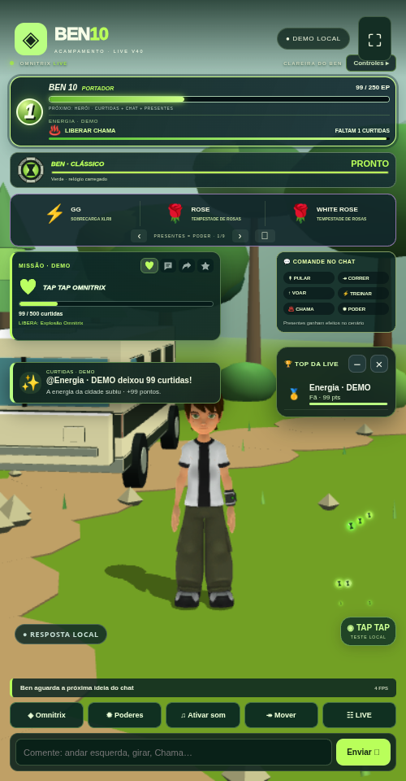

# Ben 10 LIVE V40 · IA corrigida e energia de DNA

[Baixar BEN10_LIVE_V40_TERMUX.zip](https://github.com/Elielpg/v4-ff/raw/refs/heads/main/BEN10_LIVE_V40_TERMUX.zip)



## Respostas Gemini

- Recupera uma chave cadastrada sem seleção ativa quando não há uma chave do ambiente selecionada.
- **Adicionar e usar esta chave** ativa a chave informada. Colar uma já cadastrada seleciona a existente.
- O teste e as perguntas do público usam o mesmo serviço, chave e modelo. O teste mostra uma resposta de exemplo à pergunta digitada.
- **Chave salva** e **Gemini respondendo** são estados separados. Cota, chave inválida, acesso, conexão e modelo indisponível têm mensagens próprias.
- Modelo **auto** consulta os modelos de texto disponíveis e escolhe um Flash. Um modelo indisponível pode ser substituído por outro Flash listado pelo Google usando a mesma chave. Não há troca automática de chaves para contornar cotas.
- O público não recebe instruções para conectar API. Uma falha fica no painel do operador e a interface identifica quando a resposta é local.

Depois de atualizar: **☷ LIVE → IA e voz → Usar e testar**, ou cadastre em **Adicionar e usar esta chave**. Deixe o modelo em **auto** e confira a resposta de exemplo. Se o Google recusar acesso/cota, a mensagem indica a causa; confirme as condições da chave no Google AI Studio. A voz gratuita do aparelho continua disponível separadamente.

## TAP TAP e desbloqueios

As animações de curtida agora são **esferas verdes de energia com o símbolo do Omnitrix**. A faixa permanente mostra o próximo alien, a barra de energia e quantas curtidas faltam.

Metas iniciais de curtidas acumuladas: Chama **100**, Besta **250**, Diamante **500**, XLR8 **800**, Quatro Braços **1.200**, Aquático **1.700**, Fantasmático **2.300**, Cipó Selvagem **3.000**, Bola de Canhão **4.000** e Alien X extra **5.500**.

Ao liberar Chama com 100, a faixa passa a mostrar Besta com 150 restantes. As curtidas não são gastas ao transformar. O relógio conserva tempo, seleção e recarga. Os ícones originais ficam apagados enquanto o DNA está bloqueado; presentes aguardam o DNA na fila e depois respeitam a recarga.

**LIVE → Laboratório → DNA por TAP TAP** permite editar as metas ou desligar o desbloqueio para usar modo livre. DNAs já conquistados são preservados ao editar as metas. Progresso salvo no aparelho, separado entre DEMO e TikTok. As missões coletivas da V39 continuam com suas próprias rodadas, sem zerar o DNA acumulado.

Na demonstração, tocar no cenário ou no botão **TESTE LOCAL** testa a energia. Durante a LIVE, **PRÉVIA LOCAL** só mostra a animação. As curtidas reais chegam pelo conector; testes locais não liberam aliens da LIVE.

## Atualizar no Termux

Depois de baixar o ZIP, use a pasta anterior (ajuste o caminho se necessário):

```sh
cd ~/ben10-v34/game
bash backup.sh
bash update.sh --archive ~/storage/downloads/BEN10_LIVE_V40_TERMUX.zip --start
```

Atualize a página no Chrome e confira **V40 / 40.0.0**. Chaves, `.env`, modelos personalizados e dados existentes são preservados. Para iniciar outra vez, dentro da mesma pasta: `bash start.sh`.

Instalação nova: extraia o ZIP, entre em `game`, execute `bash install.sh` e `bash start.sh`. Ative **♫** para sons e falas.

## Verificação

**161 testes passaram.** A integração usa as rotas HTTP reais com um Gemini offline de teste para verificar seleção de chaves, pergunta pública, teste, substituição de modelo, cota e chave inválida. Também verifica persistência após reiniciar, desbloqueios, origens confiáveis, fila de presentes, relógio e modo livre.

O Chromium confirmou respostas ao público, erros corretos, esferas verdes, Chama com 100 curtidas, próximo alien, botões bloqueados/liberados, espera do presente e layouts. A conferência final foi feita em instalações temporárias sem copiar chaves/progresso existentes. O ZIP foi extraído e seu servidor iniciado normalmente, sem o provedor de teste. Integridade e ausência de dados pessoais conferidas.

Não foi usada uma chave Google real, LIVE real ou Android físico. Confirme o acesso da sua chave pelo teste na aba **IA e voz**; a chegada de curtidas reais depende do conector. O ZIP não contém chaves ou progresso pessoais.

Guia completo, fontes, créditos e relatórios: `game/docs/V40_IA_E_DNA.md`, `game/docs/MODEL_CREDITS.md` e `game/reports/v40/`.

[Checksum SHA-256](BEN10_LIVE_V40_TERMUX.zip.sha256)
