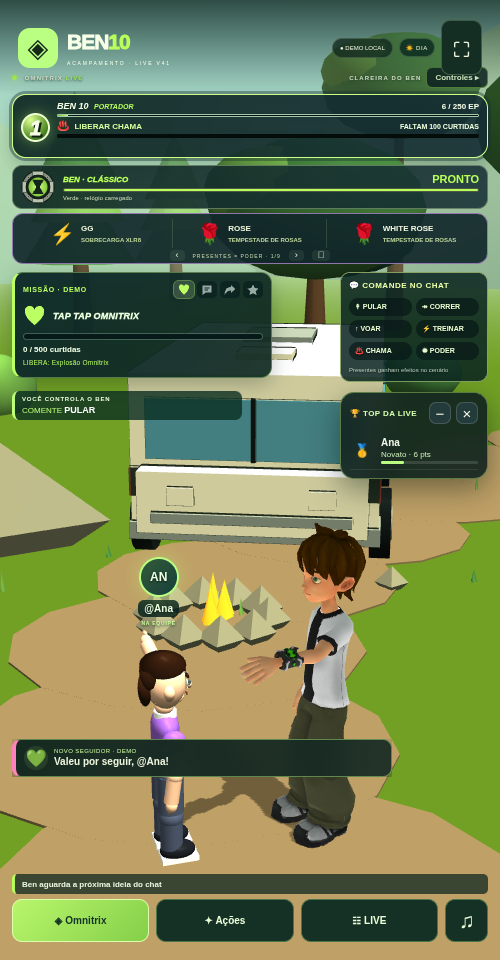

# Ben 10 LIVE V41 · Visitantes e voz de IA

[Baixar BEN10_LIVE_V41_TERMUX.zip](https://github.com/Elielpg/v4-ff/raw/refs/heads/main/BEN10_LIVE_V41_TERMUX.zip)



## O que mudou

- Avatar aleatório entre cinco estilos, com nome/foto sobre a cabeça. Sem foto disponível pelo conector, usa iniciais. Até seis visitantes recentes por origem, com câmera de chegada limitada entre entradas.
- Ben calcula um caminho até o novo seguidor e acena. Comandos manuais têm preferência sobre a caminhada automática.
- Fila única de fala: presentes promovem a pergunta pendente do apoiador e o agradecimento. A fala atual termina normalmente; após duas falas prioritárias, o comentário comum mais antigo tem uma vez, se houver.
- Conversa mais curta e com contexto recente por pessoa. Ben convida ao TAP TAP e comenta a energia em intervalos, sem uma fala por curtida.
- Esferas 3D saem do chão e entram no Omnitrix do pulso animado, ou no emblema durante as formas alienígenas, com brilho/som. Progresso de DNA e curtidas restantes preservados.
- Dia, tarde e noite sincronizados, com luz, céu e ambiente sonoro. Ciclo automático ou período fixo em **LIVE → Ajustes**.
- Emissão dos poderes acompanha a mão animada; o sopro de fogo usa a boca. Transformações, relógio original e recarga verde/vermelha mantidos.
- Quatro botões embaixo: Omnitrix, Ações, LIVE e som. Poderes, movimento, chat de teste, TAP TAP local e retorno da câmera ficam em Ações. Avisos recentes ocupam menos espaço. Ranking, ícones e painel do chat mantidos.

## Voz: somente IA

A voz do aparelho foi retirada do fluxo de fala, inclusive como substituta e nas instalações antigas que a tinham selecionado. Escolha **Gemini TTS** ou **ElevenLabs** em **LIVE → IA e voz**.

1. Adicione/selecione sua chave Gemini e execute o teste de conversa.
2. Escolha Gemini na seção de voz, deixe o modelo em `auto`, salve e use **Testar voz IA**.
3. Toque em **♫** para o navegador permitir áudio.

A mesma chave pode ter texto funcionando e não ter acesso/cota para voz. O teste de áudio é separado. Em caso de falha, as respostas continuam em legenda, com diagnóstico para o operador. Não há promessa de voz ilimitada gratuita; as cotas e condições dependem do provedor. Não usa a gravação ou clonagem da dublagem original.

As falas automáticas podem ser desligadas na aba **LIVE**, em **Ben recebe visitantes e agradece ao público**, preservando as perguntas.

## Atualizar no Termux

Depois de baixar o ZIP, entre na pasta instalada (ajuste se tiver outro caminho):

```sh
cd ~/ben10-v34/game
bash backup.sh
bash update.sh --archive ~/storage/downloads/BEN10_LIVE_V41_TERMUX.zip --start
```

Atualize a página e confira **V41 / 41.0.0**. Chaves, `.env`, modelos personalizados e dados são preservados. Para iniciar depois: `bash start.sh`.

Instalação nova: extraia o ZIP, entre em `game`, execute `bash install.sh` e `bash start.sh`.

O ZIP tem uma pasta `game/`: isso é a estrutura interna do pacote. O link acima baixa o arquivo ZIP; depois extraia para instalar. Se abrir no navegador interno do TikTok, use o navegador externo.

## Conferência

**174 testes aprovados.** Cobrem chaves e modelos, recuperação de falhas TTS, memória por pessoa/origem, prioridade/fairness, caminhos e obstáculos, perfis/fotos, energia, relógio, progresso e atualizador.

O Chromium verificou chegada com foto, câmera, caminhada/cumprimento, prioridade real na reprodução da fila, esferas absorvidas, dia/tarde/noite, poderes, relógio original e layouts 360/500/1280. Confirmou que nenhuma voz do aparelho é chamada, inclusive quando a cota falha.

Os testes usam cópias temporárias sem chaves/progresso existentes. Google, foto e eventos são simulados offline; o WAV da fixture testa transporte/reprodução, sem validar timbre real. Não houve validação com chave Google real, LIVE real ou Android físico. Confirme texto/voz da sua própria chave antes da transmissão. A chegada de fotos/eventos depende do conector. Os recursos não garantem visualizações ou seguidores.

O ZIP foi extraído e seu servidor iniciado, com integridade e ausência de dados pessoais conferidas. Relatórios, fontes e guia: `game/reports/v41/` e `game/docs/V41_RECEPCAO_E_VOZ_IA.md`. Créditos em `game/docs/MODEL_CREDITS.md`.

[Checksum SHA-256](BEN10_LIVE_V41_TERMUX.zip.sha256)
